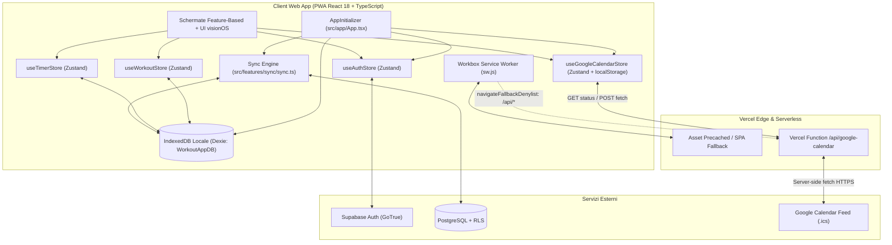

# Architettura del Sistema — WorkoutApp

WorkoutApp è una Progressive Web App (PWA) progettata secondo il paradigma **Local-First**, organizzata con struttura **feature-based**, abbinata a sincronizzazione cloud su **Supabase (PostgreSQL + Auth)** e a un proxy serverless dedicato per **Google Calendar**.

---

## 1. Principi Architetturali

1. **Zero Latenza & Funzionamento Offline Garantito**:
   Ogni operazione durante l'allenamento (completamento di una serie, avvio o estensione del timer di recupero, tracciamento cardio, modifica pesi) viene scritta immediatamente su **IndexedDB** tramite **Dexie.js** (`WorkoutAppDB`). Nessuna schermata attende risposte di rete per registrare i dati.
2. **Organizzazione Feature-Based**:
   Il codice in `src/` è suddiviso in tre strati chiari:
   - `src/app/`: bootstrap applicativo, `ErrorBoundary`, inizializzazione Lenis, routing React Router v6.
   - `src/features/`: moduli verticali autonomi per dominio (`auth`, `calendar`, `home`, `program`, `progress`, `settings`, `sync`, `timer`, `workout`), ciascuno con schermate, store, helper e test collocati insieme.
   - `src/shared/`: primari UI, layout shell, layer DB/repository, selettori puri, tipi di dominio e stili condivisi.
3. **Multi-Dispositivo Senza Conflitti**:
   Tutti i record (`Program`, `SessionTemplate`, `ExerciseTemplate`, `Workout`, `WorkoutExerciseLog`, `SetLog`) usano identificativi **UUID** generati sul client tramite [`src/shared/lib/ids.ts`](../src/shared/lib/ids.ts), consentendo `upsert` idempotenti verso PostgreSQL.
4. **Google Calendar Permanente Senza Esposizione di Segreti**:
   Poiché i feed `.ics` di Google Calendar non espongono header CORS per richieste dirette dal browser e l'URL privato contiene un token segreto, il fetch avviene tramite la Vercel Function [`api/google-calendar.ts`](../api/google-calendar.ts).

---

## 2. Diagramma Architetturale



---

## 3. Suddivisione delle Cartelle (`src/`)

```text
src/
├── main.tsx
├── vite-env.d.ts
├── app/
│   ├── App.tsx                        # ErrorBoundary, Lenis smooth scroll, AppInitializer
│   └── router.tsx                     # AppRouter (Home e Workout eager; altre rotte lazy)
├── features/
│   ├── auth/                          # AuthModal, authStore, __tests__/
│   ├── calendar/                      # CalendarScreen, PlanWorkoutSheet, googleCalendarStore,
│   │                                  # googleCalendar.ts, ical.ts, __tests__/
│   ├── home/                          # HomeScreen
│   ├── program/                       # ProgramScreen, EditProgramScreen, SessionDetailScreen,
│   │                                  # EditSessionScreen, EditExerciseScreen
│   ├── progress/                      # ProgressScreen, ExerciseHistoryScreen
│   ├── settings/                      # SettingsScreen
│   ├── sync/                          # supabase.ts, sync.ts, __tests__/
│   ├── timer/                         # TimerComponents, timerStore, __tests__/
│   └── workout/                       # WorkoutOverviewScreen, ExerciseFocusScreen,
│                                      # ExerciseCompletedScreen, WorkoutCompletedScreen,
│                                      # WorkoutHistoryScreen, WeightEditorSheet, workoutStore, __tests__/
└── shared/
    ├── assets/brand/                  # workout-lab-logo.svg
    ├── components/
    │   ├── layout/                    # ScreenHeader, BottomNavigation, AppShell
    │   └── ui/                        # GlassCard, Button, IconButton, Toggle, ConfirmDialog, ecc.
    ├── db/
    │   ├── database.ts                # Classe WorkoutDB (Dexie v1)
    │   ├── repositories.ts            # programRepo, workoutRepo, settingsRepo, appStateRepo, resetAllData
    │   ├── seed.ts                    # Scheda predefinita (CURRENT_SHEET_REVISION = 2) e migrazione UUID-safe
    │   └── progressData.ts            # Dataset storico precompilato per demo/ripristino
    ├── lib/
    │   ├── backup.ts                  # Export/import JSON completo
    │   ├── formatters.ts              # Formattazione pesi italiani, date e durate
    │   ├── gymSchedule.ts             # Orari di apertura della palestra
    │   ├── ids.ts                     # Generatore UUID
    │   ├── selectors.ts               # Calcolo metriche, progressioni, stalli, prossima seduta
    │   ├── strings.ts                 # Testi UI centralizzati in italiano
    │   ├── tabSync.ts                 # BroadcastChannel / storage sync tra schede aperte
    │   └── useDialogA11y.ts           # Escape, focus trap e ripristino focus modali
    ├── styles/
    │   ├── globals.css                # Token CSS, materiali glass e helper safe-area iPhone
    │   └── tailwind.css               # Entry Tailwind (@base, @components, @utilities)
    ├── test/                          # setup.ts + suite Vitest shared e ui/
    └── types/
        └── index.ts                   # Interfacce di dominio (Program, Workout, AppSettings, AppState, ecc.)
```

---

## 4. Architettura Integrazione Google Calendar (`/api/google-calendar`)

Il collegamento permanente a Google Calendar combina configurazione server-side, override personale opzionale, persistenza cloud e cache locale offline:

### Endpoint Serverless (`api/google-calendar.ts`)
- **`GET /api/google-calendar`**:
  - Legge `process.env.GOOGLE_CALENDAR_ICAL_URL`, lo valida con `parseGoogleIcalUrl()` e restituisce `{ "configured": boolean }` con `Cache-Control: no-store`.
  - Non espone mai l'URL segreto al client.
- **`POST /api/google-calendar`**:
  - Accetta `{ "useDefault": true }` (oppure body vuoto) per usare `process.env.GOOGLE_CALENDAR_ICAL_URL`, oppure `{ "url": "..." }` per un feed personale passato nel body (mai in query string per evitare la registrazione nei log).
  - **Protezione anti-SSRF**: `parseGoogleIcalUrl()` accetta esclusivamente URL `https://` (normalizzando `webcal://` -> `https://`) con host esatto `calendar.google.com`, nessuna porta custom o credenziali embedded, path `/calendar/ical/.../*.ics`, lunghezza massima `2048` caratteri.
  - **Limiti di fetch**: `redirect: 'manual'` con al massimo 1 redirect verificato nuovamente contro gli host ammessi, timeout di `10.000 ms`, payload massimo `5 MB` e controllo che la risposta inizi con `BEGIN:VCALENDAR`.

### Store Reattivo & Modalità di Connessione (`src/features/calendar/googleCalendarStore.ts`)
Lo store Zustand `useGoogleCalendarStore` persiste in `localStorage` sotto la chiave `workout.googleCalendar.v1` (`icalUrl`, `connectionMode`, `serverConfigured`, `calendarName`, `events`, `lastSyncedAt`) e gestisce due modalità (`GoogleCalendarConnectionMode`):

- **`'user-ical'`**: URL iCal personale salvato dall'utente (in `localStorage`, in `settingsRepo` su IndexedDB e sincronizzato su Supabase `user_settings.google_ical_url`). Ha sempre precedenza sul calendario predefinito del server.
- **`'server-default'`**: attivata automaticamente da `bootstrap()` quando non è presente un `icalUrl` personale e `GET /api/google-calendar` risponde `{ configured: true }`. I dati vengono scaricati tramite `POST /api/google-calendar` con `{ useDefault: true }`.
- **`null`**: nessun calendario collegato.

### Resilienza Offline & Finestra Eventi
- `bootstrap()` viene invocato automaticamente all'avvio in [`src/app/App.tsx`](../src/app/App.tsx) e al mount di [`CalendarScreen`](../src/features/calendar/CalendarScreen.tsx) e [`SettingsScreen`](../src/features/settings/SettingsScreen.tsx), con deduplicazione tramite promise `bootstrapInflight`.
- `refresh()` salta le chiamate di rete se `events` è già popolato e `lastSyncedAt` è più recente di `15 minuti` (`GOOGLE_CALENDAR_STALE_MS`), a meno che non venga richiesto `{ force: true }`.
- **Guard offline**: se `navigator.onLine === false`, o se la richiesta `GET`/`POST` fallisce per assenza di rete o errore `5xx`, lo store **non azzera mai** `connectionMode`, `icalUrl` o gli `events` già in cache, mostrando un messaggio diagnostico non bloccante.
- Il parser iCal puro (`parseIcal` in [`src/features/calendar/ical.ts`](../src/features/calendar/ical.ts)) espande gli eventi ricorrenti nella finestra mobile **da -3 mesi a +12 mesi**.

---

## 5. PWA & Service Worker Workbox

La configurazione PWA in [`vite.config.ts`](../vite.config.ts) usa `vite-plugin-pwa` (`registerType: 'autoUpdate'`):

- **Precache**: `globPatterns: ['**/*.{js,css,html,ico,png,svg,woff2}']` (con `includeAssets` per favicon, icone PWA, screenshot e splash screen iOS).
- **Routing SPA sicuro per le API**:
  ```ts
  workbox: {
    globPatterns: ['**/*.{js,css,html,ico,png,svg,woff2}'],
    navigateFallback: '/index.html',
    navigateFallbackDenylist: [/^\/api\//],
  }
  ```
  `navigateFallbackDenylist: [/^\/api\//]` impedisce al Service Worker di intercettare le richieste verso `/api/google-calendar` restituendo `index.html`, assicurando che le chiamate verso la Serverless Function raggiungano sempre il backend (o falliscano in modo pulito offline).
- **Code splitting**: chunk dedicati per `vendor-framer` (`framer-motion`) e `vendor-dnd` (`@dnd-kit/*`) oltre al lazy loading delle schermate non critiche in [`src/app/router.tsx`](../src/app/router.tsx).

---

## 6. Ciclo di Vita dell'Applicazione

1. **Avvio (`AppInitializer`)**:
   - Esegue `seedDatabase()` (crea o aggiorna la scheda predefinita preservando gli UUID e i carichi progrediti).
   - Richiede `navigator.storage.persist()` (best-effort) per proteggere IndexedDB dallo sfoltimento automatico iOS/browser.
   - Carica in parallelo `timerStore.loadFromDB()`, `workoutStore.loadActiveWorkout()` e `authStore.initAuth()`.
   - Sblocca Web Audio al primo evento `touchstart` / `click` e inizializza `Lenis` (disattivato se `prefers-reduced-motion: reduce`).
   - Avvia `useGoogleCalendarStore.getState().bootstrap()` in background e, se esiste un utente Supabase autenticato, avvia `syncAll(currentUser.id)`.
2. **Durante il Workout**:
   - Ogni set registrato viene persistito atomicamente in Dexie tramite `workoutRepo` (inclusi `setLogs` e stato cardio su reload).
   - Il timer calcola il residuo con `endAt - Date.now()` e salva il proprio `TimerState` in `appState`.
3. **Fine Workout**:
   - `workoutStore.completeWorkout()` imposta `status: 'completed'`, aggiorna `completedAt` e, se autenticato, invoca `syncAll(user.id)` in background.
