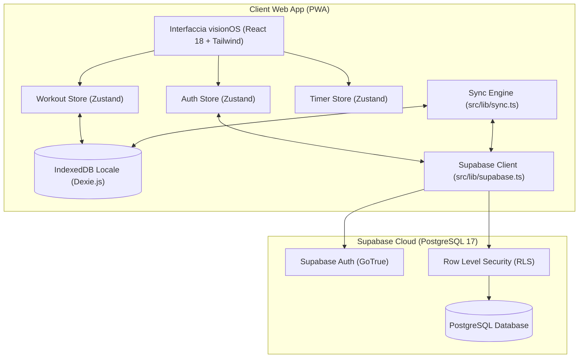

# Architettura del Sistema — WorkoutApp

WorkoutApp è una Progressive Web App (PWA) progettata secondo il paradigma **Local-First**, abbinato a un backend cloud opzionale e resiliente su **Supabase (PostgreSQL + Auth)**.

---

## 1. Principi Architetturali

1. **Zero Latenza & Funzionamento Offline Garantito**:
   Qualsiasi interazione durante l'allenamento (completamento di una serie, avvio o stop del timer, inserimento di carichi e note) viene registrata prima nel database locale del dispositivo (**IndexedDB** tramite **Dexie.js**). L'app non si blocca mai e non attende risposte di rete per completare un'operazione.

2. **Sincronizzazione Cloud Trasparente**:
   Quando l'utente effettua l'accesso o crea un account, il modulo di sincronizzazione (`src/lib/sync.ts`) sincronizza in background i dati locali con il cloud Postgres. Se l'utente si allena senza connessione, i workout verranno inviati automaticamente non appena il dispositivo torna online.

3. **Multi-Dispositivo Senza Conflitti**:
   Gli ID dei record (schede, sessioni, esercizi, workout e serie) sono generati come **UUID v4** sul client. Ciò garantisce che i dati creati offline su diversi dispositivi (es. iPhone e iPad) possano confluire nel database PostgreSQL senza conflitti di chiave primaria.

4. **Design System Apple visionOS**:
   L'interfaccia adotta un'estetica in vetro smerigliato (*Frosted Glass*), una palette neutra monocromatica priva di gradienti artificiali, griglia geometrica a passo 8, tipografia a due pesi (400 e 600) e assenza totale di testi in maiuscolo forzato (*zero AI slop*).

---

## 2. Diagramma Architetturale



---

## 3. Suddivisione delle Cartelle (`src/`)

```
src/
├── app/                  # Routing, shell applicativa e configurazione provider
│   ├── App.tsx           # Entry component, inizializzatore Auth e Sync
│   └── router.tsx        # Mappatura delle rotte con React Router v6
├── assets/               # Risorse statiche, icone vettoriali e logo di brand
├── components/           # Componenti riutilizzabili
│   ├── layout/           # AppShell, ScreenHeader, BottomNav
│   └── ui/               # GlassCard, Button, Badge, Stepper, Toggle, Dialog
├── db/                   # Livello di persistenza locale IndexedDB
│   ├── database.ts       # Definizione schema Dexie (tabelle: programs, workouts, settings, appState)
│   ├── repositories.ts   # Repository pattern per accesso tipizzato
│   ├── seed.ts           # Seed della scheda iniziale e gestione migrazioni di versione
│   └── progressData.ts   # Modello dati storici (9 workout e progressioni)
├── features/             # Moduli funzionali organizzati per dominio
│   ├── auth/             # Modale di accesso/registrazione Apple visionOS
│   ├── calendar/         # Calendario mensile con giorni di allenamento
│   ├── home/             # Cruscotto principale, prossima seduta e stato palestra
│   ├── program/          # Gestione ed editing di schede, sessioni ed esercizi
│   ├── progress/         # Metriche, trend, grafici e massimali
│   ├── settings/         # Impostazioni, orari palestra, backup JSON, sincronizzazione cloud
│   ├── timer/            # Timer anti-drift per recupero tra le serie
│   └── workout/          # Esecuzione live dell'allenamento e log serie
├── lib/                  # Logica di business pura, selettori e utilità
│   ├── formatters.ts     # Formattazione durate, pesi decimali italiani, date
│   ├── gymSchedule.ts    # Calcolo orari di apertura della palestra
│   ├── ids.ts            # Generatore UUID v4
│   ├── selectors.ts      # Calcolo metriche, serie, trend e stalli
│   ├── supabase.ts       # Inizializzazione client Supabase
│   ├── sync.ts           # Motore di sincronizzazione bidirezionale
│   └── tabSync.ts        # Canale broadcast per sincronizzare tab aperte
├── stores/               # Store globali di stato reattivo (Zustand)
│   ├── authStore.ts      # Stato utente, credenziali e sessione attiva
│   └── workoutStore.ts   # Stato della sessione di allenamento in corso
├── styles/               # Stili globali CSS e importazioni font
├── test/                 # Test unitari e integration test (Vitest + Testing Library)
└── types/                # Definizioni dei tipi TypeScript (Data Contract)
```

---

## 4. Flusso del Ciclo di Vita Utente

1. **Avvio dell'Applicazione**:
   - `AppInitializer` (`src/app/App.tsx`) verifica l'integrità del database locale `Dexie`.
   - Se il database è vuoto, viene eseguita la procedura di `seedDatabase()`.
   - Lo store `authStore` controlla se esiste una sessione Supabase attiva nella memoria protetta del client.
   - Se l'utente è autenticato ed è presente connessione, viene avviato `syncAll(user.id)`.

2. **Durante il Workout**:
   - Ogni serie completata viene scritta immediatamente in `Dexie`.
   - Non viene effettuata alcuna chiamata bloccante a server esterni.
   - Il timer anti-drift calcola il tempo rimanente usando `endAt - Date.now()`, resistendo a refresh, minimizzazione del browser e blocco dello schermo del telefono.

3. **Completamento del Workout**:
   - `workoutStore.completeWorkout()` aggiorna lo stato locale del workout a `completed`.
   - Se l'utente è autenticato, viene invocato `syncAll()` in background per salvare il workout sul cloud.
