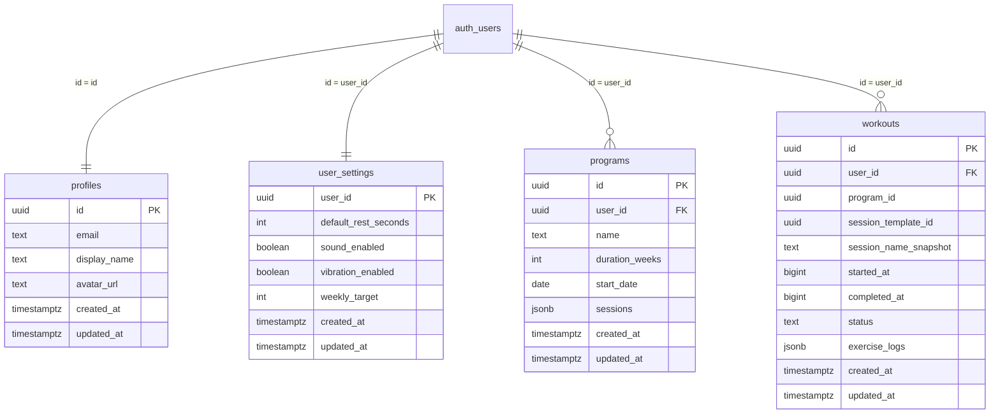

# Database e Sincronizzazione Cloud — WorkoutApp

Questo documento descrive l'architettura dei dati di WorkoutApp: il database locale IndexedDB, lo schema PostgreSQL su Supabase, le politiche di sicurezza Row Level Security (RLS) e l'algoritmo di sincronizzazione local-first.

---

## 1. Schema del Database Locale (IndexedDB / Dexie.js)

Il database locale si chiama `WorkoutAppDB` (versione 1) ed è accessibile via [src/db/database.ts](file:///Volumes/SSD_ALE/LavoriPersonali/WorkoutApp/src/db/database.ts).

### Tabelle Locali
- `programs`: Contiene le schede di allenamento, con sessioni ed esercizi nidificati in formato strutturato. Chiavi: `id, createdAt`.
- `workouts`: Registro cronologico di ogni sessione svolta (attiva, completata, annullata) con relative serie e carichi. Chiavi: `id, programId, sessionTemplateId, status, startedAt, completedAt`.
- `settings`: Tabella singleton (chiave: `'default'`) per le preferenze dell'app (tempo di recupero, feedback sonoro, vibrazione, target settimanale).
- `appState`: Tabella singleton (chiave: `'default'`) per preservare lo stato del timer attivo e del workout in corso anche dopo un riavvio o crash dell'app.

---

## 2. Schema PostgreSQL Cloud (Supabase)

Il backend cloud risiede su PostgreSQL 17 in hosting su Supabase, definito nella migrazione [supabase/migrations/20261103000000_create_workout_schema.sql](file:///Volumes/SSD_ALE/LavoriPersonali/WorkoutApp/supabase/migrations/20261103000000_create_workout_schema.sql).



---

## 3. Politiche di Sicurezza Row Level Security (RLS)

Tutte le tabelle pubbliche hanno la Row Level Security abilitata. Nessun utente non autenticato può accedere o modificare i dati.

Le policy applicate seguono i più rigidi standard di sicurezza Supabase:
- **`TO authenticated`**: le richieste anonime vengono respinte a monte.
- **Subselect per `auth.uid()`**:
  ```sql
  CREATE POLICY "Users can read own workouts"
    ON public.workouts
    FOR SELECT
    TO authenticated
    USING ((select auth.uid()) = user_id);
  ```
  L'utilizzo di `(select auth.uid()) = user_id` al posto di `auth.uid() = user_id` consente all'ottimizzatore di Postgres di valutare la funzione una sola volta per query anziché per ogni riga, massimizzando le performance degli indici.

---

## 4. Trigger di Provisioning Automatico (`handle_new_user`)

Quando un nuovo utente completa la registrazione in `auth.users`, un trigger con privilegi `SECURITY DEFINER` e `search_path` protetto crea all'istante il suo profilo e le sue impostazioni:

```sql
CREATE OR REPLACE FUNCTION public.handle_new_user()
RETURNS TRIGGER
LANGUAGE plpgsql
SECURITY DEFINER
SET search_path = public, auth
AS $$
BEGIN
  INSERT INTO public.profiles (id, email, display_name, avatar_url)
  VALUES (
    NEW.id,
    NEW.email,
    COALESCE(NEW.raw_user_meta_data->>'full_name', NEW.raw_user_meta_data->>'name', split_part(NEW.email, '@', 1)),
    NEW.raw_user_meta_data->>'avatar_url'
  )
  ON CONFLICT (id) DO NOTHING;

  INSERT INTO public.user_settings (user_id)
  VALUES (NEW.id)
  ON CONFLICT (user_id) DO NOTHING;

  RETURN NEW;
END;
$$;
```

---

## 5. Algoritmo di Sincronizzazione (`src/lib/sync.ts`)

La sincronizzazione opera in due fasi:

### Fase 1: Push (Locale → Cloud)
1. Legge le schede e i workout presenti in IndexedDB.
2. Formatta i record associando il `user_id` della sessione attiva.
3. Esegue un `upsert` in massa su Supabase con clausola `ON CONFLICT (id) DO UPDATE`.

### Fase 2: Pull (Cloud → Locale)
1. Recupera da Supabase tutte le schede e i workout dell'utente.
2. Inserisce o aggiorna i record in IndexedDB tramite `bulkPut`, preservando i record già salvati e integrando eventuali nuovi workout eseguiti da altri dispositivi.

### Gestione degli Errori e Connettività
- Se la rete non è disponibile o la chiamata HTTP fallisce con timeout, lo stato di sync viene impostato su errore senza bloccare l'interfaccia.
- I listener reattivi registrati con `subscribeSyncStatus()` aggiornano la card "Account e cloud" nelle Impostazioni indicando la data dell'ultimo sync riuscito.

---

## 6. Formato del File di Backup JSON

Gli utenti possono esportare e ripristinare i propri dati tramite un file JSON conforme allo schema:

```json
{
  "schemaVersion": 1,
  "exportedAt": "2026-11-03T10:54:22.000Z",
  "app": "workout-app",
  "data": {
    "programs": [...],
    "workouts": [...],
    "settings": [...],
    "appState": [...]
  }
}
```
Un file di riferimento contenente i 9 workout storici è disponibile in `data/workout-backup-progressi.json` e `public/workout-backup-progressi.json`.
