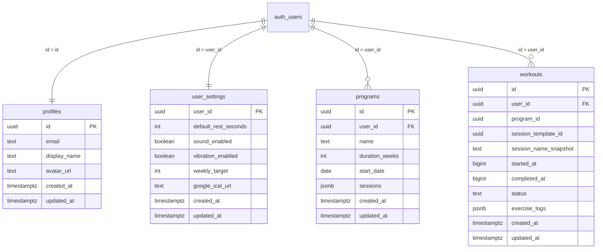

# Database e Sincronizzazione Cloud — WorkoutApp

Questo documento descrive lo storage locale **IndexedDB (Dexie.js)**, lo schema **PostgreSQL su Supabase**, le policy **Row Level Security (RLS)**, il trigger di provisioning utente, il motore bidirezionale `syncAll` e il formato di backup JSON.

---

## 1. Schema del Database Locale (IndexedDB / Dexie.js)

Il database locale `WorkoutAppDB` (versione `1`) è definito in [`src/shared/db/database.ts`](../src/shared/db/database.ts) e incapsulato dai repository transazionali in [`src/shared/db/repositories.ts`](../src/shared/db/repositories.ts).

| Tabella Dexie | Chiave Primaria & Indici | Ruolo |
|---------------|--------------------------|-------|
| `programs` | `id, createdAt` | Schede di allenamento con `sessions` ed `exercises` annidati, `durationWeeks`, `startDate`, `sheetRevision` |
| `workouts` | `id, programId, sessionTemplateId, status, startedAt, completedAt` | Registro delle sedute (`active`, `completed`, `cancelled`) con snapshot nomi/parametri ed `exerciseLogs` |
| `settings` | `id` (singleton `'default'`) | Preferenze (`defaultRestSeconds`, `soundEnabled`, `vibrationEnabled`, `weeklyTarget`, `googleIcalUrl`) |
| `appState` | `id` (singleton `'default'`) | Stato effimero persistito tra reload (`activeWorkoutId`, `activeProgramId`, `timerState`) |

### Note sui Repository e Coerenza Transazionale
- Le mutazioni su `settings`, `appState`, `programs` e `workouts` utilizzano `db.transaction('rw', ...)` per evitare race condition (es. update concorrenti di timer e workout attivo).
- Quasi tutte le scritture chiamano `notifyTabSync()` ([`src/shared/lib/tabSync.ts`](../src/shared/lib/tabSync.ts)) per mantenere sincronizzate più schede aperte dello stesso browser.
- Il seeding automatico (`seedDatabase()` in [`src/shared/db/seed.ts`](../src/shared/db/seed.ts)) aggiorna le schede predefinite incrementando `sheetRevision` (attualmente `CURRENT_SHEET_REVISION = 2`) preservando UUID esistenti, sessioni aggiunte dall'utente e pesi progrediti.

---

## 2. Schema PostgreSQL Cloud (Supabase)

Lo schema cloud è definito dalle due migrazioni SQL presenti in `supabase/migrations/`:
1. [`supabase/migrations/20261103000000_create_workout_schema.sql`](../supabase/migrations/20261103000000_create_workout_schema.sql) — Tabelle core, indici, policy RLS e trigger `on_auth_user_created`.
2. [`supabase/migrations/20261113000000_add_google_calendar_to_settings.sql`](../supabase/migrations/20261113000000_add_google_calendar_to_settings.sql) — Aggiunta colonna `google_ical_url` a `public.user_settings` e hardening permessi di `handle_new_user()`.



### Indici PostgreSQL
- `public.programs`:
  - `idx_programs_user_id` su `(user_id)`
  - `idx_programs_updated_at` su `(updated_at DESC)`
- `public.workouts`:
  - `idx_workouts_user_id` su `(user_id)`
  - `idx_workouts_started_at` su `(started_at DESC)`
  - `idx_workouts_status` su `(status)` (`CHECK (status IN ('active', 'completed', 'cancelled'))`)
  - `idx_workouts_updated_at` su `(updated_at DESC)`

---

## 3. Sicurezza: Row Level Security (RLS) & Trigger Hardened

Tutte le tabelle nel schema `public` (`profiles`, `user_settings`, `programs`, `workouts`) hanno **RLS abilitata**.

### Regole delle Policy RLS
- Tutte le policy sono ristrette al ruolo **`TO authenticated`**: le richieste anonime vengono rifiutate a livello di database.
- La verifica di proprietà usa il subselect `(select auth.uid())` (es. `USING ((select auth.uid()) = user_id)`) in modo che PostgreSQL valuti l'UUID dell'utente una sola volta per statement anziché per ogni riga:
  - `profiles`: `SELECT`, `UPDATE` su `id`.
  - `user_settings`: `SELECT`, `INSERT`, `UPDATE` su `user_id`.
  - `programs`: `SELECT`, `INSERT`, `UPDATE`, `DELETE` su `user_id`.
  - `workouts`: `SELECT`, `INSERT`, `UPDATE`, `DELETE` su `user_id`.

### Trigger `handle_new_user()`
Alla creazione di un utente in `auth.users` (`AFTER INSERT`), il trigger `on_auth_user_created` esegue `public.handle_new_user()`:
- Dichiarata con `SECURITY DEFINER` e `SET search_path = public, auth` per prevenire attacchi di *search_path hijacking*.
- Inserisce in modo idempotente (`ON CONFLICT ... DO NOTHING`) la riga iniziale in `public.profiles` e in `public.user_settings`.
- La seconda migrazione applica esplicitamente l'hardening dei privilegi:
  ```sql
  REVOKE EXECUTE ON FUNCTION public.handle_new_user() FROM PUBLIC, anon, authenticated;
  ```
  impedendo l'invocazione diretta della funzione via RPC da client pubblici o autenticati.

---

## 4. Engine di Sincronizzazione Bidirezionale (`src/features/sync/sync.ts`)

La funzione principale `syncAll(userId)` coordina la sincronizzazione tra `Dexie` (`WorkoutAppDB`) e `Supabase`:

- Se `isSupabaseConfigured()` è `false`, `userId` è assente o una sincronizzazione è già in corso (`syncStatus.isSyncing`), `syncAll` termina senza errori.
- Lo stato (`isSyncing`, `lastSyncedAt`, `error`) viene propagato ai componenti UI iscritti tramite `subscribeSyncStatus()`.

### Fase 1: Push (`pushLocalToCloud`)
1. **Schede (`programs`)**: esegue `upsert` su `programs` (`onConflict: 'id'`) mappando `startDate` (`YYYY-MM-DD`) e `sessions` JSONB.
2. **Allenamenti (`workouts`)**: esegue `upsert` su `workouts` (`onConflict: 'id'`) con `started_at`, `completed_at`, `status` e `exercise_logs` JSONB.
3. **Impostazioni (`user_settings`) & Calendario Permanente**:
   - Legge `googleIcalUrl` da `db.settings.get('default')` o da `useGoogleCalendarStore.getState().icalUrl`.
   - Include `google_ical_url` nel payload `upsert` (`onConflict: 'user_id'`) **solo se localmente è presente un URL non vuoto**: in questo modo un nuovo dispositivo con impostazioni locali vuote non sovrascrive mai l'URL Google Calendar già salvato nel cloud.

### Fase 2: Pull (`pullCloudToLocal`)
1. **Schede & Allenamenti**: scarica tutti i record dell'utente e li scrive in transazione su `db.programs` e `db.workouts` tramite `put()`.
2. **Impostazioni & Ripristino Google Calendar**:
   - Scarica `user_settings` con `.maybeSingle()`.
   - Esegue il merge conservativo tra `localIcalUrl` e `cloudSettings.google_ical_url` (`mergedIcalUrl = localIcalUrl ?? cloudIcalUrl`) e aggiorna `db.settings`.
   - Se nel cloud è presente un `cloudIcalUrl` valido e lo store locale `useGoogleCalendarStore` non ha un `icalUrl` impostato, invoca automaticamente `useGoogleCalendarStore.getState().restoreUserIcalUrl(cloudIcalUrl)`, ripristinando e aggiornando gli eventi su qualsiasi nuovo dispositivo dopo il login.

### Disconnessione Esplicita del Calendario
Quando l'utente scollega volontariamente il proprio iCal personale dalle Impostazioni, viene invocata anche `clearCloudGoogleIcalUrl(userId)` che aggiorna `user_settings.google_ical_url = null` su Supabase.

Al termine del ciclo `push -> pull`, `syncAll` aggiorna `lastSyncedAt` e invoca `notifyTabSync()`.

---

## 5. Formato del Backup JSON

Definito in [`src/shared/lib/backup.ts`](../src/shared/lib/backup.ts):

```json
{
  "schemaVersion": 1,
  "exportedAt": "2026-11-13T10:00:00.000Z",
  "app": "workout-app",
  "data": {
    "programs": [],
    "workouts": [],
    "settings": [],
    "appState": []
  }
}
```

- **Export (`downloadBackupFile`)**: esporta tutte le 4 tabelle Dexie in `workout-backup-YYYY-MM-DD.json`.
- **Import (`importBackupData`)**: valida che il JSON contenga almeno `programs` o `workouts` non vuoti, sostituisce in transazione tutte le tabelle locali, reimposta gli store in memoria (`useTimerStore`, `useWorkoutStore`) e notifica le altre schede tramite `notifyTabSync()`.
- **Backup di riferimento**: il dataset storico precompilato è disponibile in [`data/workout-backup-progressi.json`](../data/workout-backup-progressi.json).
