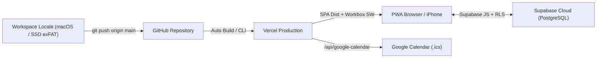

# Guida al Deployment — GitHub, Supabase & Vercel

Questa guida descrive la procedura completa per configurare il database **Supabase**, impostare le variabili d'ambiente su **Vercel** (incluso il segreto server-side per **Google Calendar**) e rilasciare in produzione.

---

## 1. Flusso di Rilascio



---

## 2. Configurazione Supabase & Migrazioni

Eseguire in ordine gli script presenti in `supabase/migrations/` sul proprio progetto Supabase (via Supabase CLI o SQL Editor):

1. [`supabase/migrations/20261103000000_create_workout_schema.sql`](../supabase/migrations/20261103000000_create_workout_schema.sql)
   - Crea le tabelle `public.profiles`, `public.user_settings`, `public.programs`, `public.workouts`.
   - Abilita RLS e crea le policy `TO authenticated` basate su `(select auth.uid())`.
   - Crea gli indici e il trigger `on_auth_user_created` (`public.handle_new_user()`).
2. [`supabase/migrations/20261113000000_add_google_calendar_to_settings.sql`](../supabase/migrations/20261113000000_add_google_calendar_to_settings.sql)
   - Aggiunge la colonna `google_ical_url TEXT` a `public.user_settings`.
   - Revoca l'esecuzione diretta di `public.handle_new_user()` da `PUBLIC, anon, authenticated`.

---

## 3. Variabili d'Ambiente (Client & Server)

Documentate in [`.env.example`](../.env.example):

| Variabile | Dove impostarla | Visibilità | Note |
|-----------|-----------------|------------|------|
| `VITE_SUPABASE_URL` | `.env.local` e Vercel (Production, Preview, Development) | Pubblica (inclusa nel bundle Vite) | URL del progetto Supabase |
| `VITE_SUPABASE_ANON_KEY` | `.env.local` e Vercel (Production, Preview, Development) | Pubblica (protetta da RLS) | Chiave `anon` pubblica di Supabase |
| `GOOGLE_CALENDAR_ICAL_URL` | `.env.local` (opzionale) e Vercel | **Solo Server-Side** | URL privato `.ics` (`https://calendar.google.com/calendar/ical/.../basic.ics`) |

> **Attenzione sicurezza**: `GOOGLE_CALENDAR_ICAL_URL` **non deve mai** avere il prefisso `VITE_`, altrimenti Vite la incorporerebbe nel bundle JavaScript pubblico. La Vercel Function [`api/google-calendar.ts`](../api/google-calendar.ts) la legge esclusivamente tramite `process.env.GOOGLE_CALENDAR_ICAL_URL`.

Comandi utili con Vercel CLI:
```bash
# Elenca le variabili configurate su Vercel
npx vercel env ls

# Aggiunge il segreto Google Calendar lato server
npx vercel env add GOOGLE_CALENDAR_ICAL_URL production

# Scarica le variabili in .env.local per test locali
npx vercel env pull .env.local
```

---

## 4. Configurazione Vercel (`vercel.json`) e CSP (`index.html`)

Il file [`vercel.json`](../vercel.json) controlla build, routing delle Serverless Functions e caching:

- **Build**: `buildCommand: "npm run build"`, `outputDirectory: "dist"`, `framework: "vite"`.
- **Rewrites SPA vs API**:
  ```json
  "rewrites": [
    { "source": "/((?!api/).*)", "destination": "/index.html" }
  ]
  ```
  Il negative lookahead `(?!api/)` garantisce che tutte le rotte applicative React Router vengano servite da `/index.html`, lasciando intatte le richieste verso `/api/google-calendar`.
- **Cache Headers**:
  - `/sw.js` e `/registerSW.js`: `Cache-Control: public, max-age=0, must-revalidate` per consentire l'aggiornamento immediato del Service Worker Workbox.
  - `/assets/(.*)`: `Cache-Control: public, max-age=31536000, immutable` per i chunk con hash generati da Vite.
- **Security Headers (`/(.*)`)**:
  - `X-Content-Type-Options: nosniff`
  - `X-Frame-Options: DENY`
  - `Referrer-Policy: strict-origin-when-cross-origin`
- **Content-Security-Policy** in [`index.html`](../index.html):
  Autorizza connessioni (`connect-src`) solo verso `'self'` (incluso `/api/google-calendar`) e `https://*.supabase.co` / `wss://*.supabase.co`.

---

## 5. Checklist Pre-Deploy e Comandi di Verifica

Prima di eseguire il push o il deploy in produzione, verificare che tutti i controlli terminino con exit code `0`:

```bash
# 1. Controllo tipi TypeScript strict
npm run typecheck

# 2. Controllo ESLint (0 warning)
npm run lint

# 3. Suite test completa (16 file, 161 test)
npm run test:run

# 4. Build di produzione + generazione Service Worker in dist/
npm run build

# 5. (Opzionale) Smoke check ed E2E headless su dist/
npm run test:e2e
```

### Push su GitHub e Deploy su Vercel
```bash
git status
git add .
git commit -m "chore: release update"
git push origin main

# Oppure deploy manuale diretto su Vercel Production
npx vercel --prod
```

---

## 6. Note su macOS e SSD Esterni exFAT (`._*`)

Quando il repository risiede su un volume **exFAT** montato su macOS, il Finder e vari tool di sistema creano automaticamente file metadata **AppleDouble** con prefisso `._*`.

- Il file [`.gitignore`](../.gitignore) esclude `._*` e [`vite.config.ts`](../vite.config.ts) esclude `**/._*` dall'esecuzione di Vitest, ma file `._*` residui dentro `src/`, `api/`, `public/` o `dist/` possono comunque interferire con scanner di asset, glob o build.
- Prima di eseguire `git add`, `npm run build` o `npx vercel --prod`, rimuovere sempre i file AppleDouble residui:
  ```bash
  find . -maxdepth 5 -name '._*' -not -path './node_modules/*' -delete
  ```
- In alternativa, su macOS è possibile usare l'utility di sistema:
  ```bash
  dot_clean -m .
  ```
