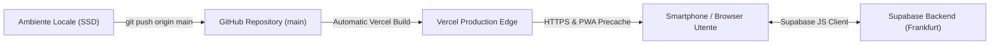

# Guida al Deployment — GitHub & Vercel

Questa guida illustra la procedura di rilascio, la gestione delle variabili d'ambiente e la configurazione della Progressive Web App (PWA) su GitHub e Vercel.

---

## 1. Architettura di Rilascio



---

## 2. Variabili d'Ambiente

Le variabili necessarie per il funzionamento dell'app sono documentate in [.env.example](file:///Volumes/SSD_ALE/LavoriPersonali/WorkoutApp/.env.example):

| Variabile | Descrizione | Visibilità |
|-----------|-------------|------------|
| `VITE_SUPABASE_URL` | URL del progetto Supabase (es. `https://jvqoxoaeywwvmpdpiuqy.supabase.co`) | Pubblica (client) |
| `VITE_SUPABASE_ANON_KEY` | Chiave pubblica anonima protetta da RLS | Pubblica (client) |

### Configurazione su Vercel
Le variabili sono già state impostate tramite Vercel CLI sui 3 ambienti:
- **Production**
- **Preview**
- **Development**

Per visualizzare o aggiornare le variabili da terminale:
```bash
# Mostra le variabili configurate
npx vercel env ls

# Sincronizza le variabili in locale
npx vercel env pull .env.local
```

---

## 3. Comandi di Build e Verifica

Prima di ogni rilascio in produzione, verificare che i seguenti passaggi abbiano esito positivo (codice 0):

```bash
# 1. Verifica tipi TypeScript
npm run typecheck

# 2. Controllo qualità del codice ESLint
npm run lint

# 3. Suite completa di test Vitest (14 suite, 141 test)
npm run test:run

# 4. Compilazione del bundle di produzione Vite + PWA Service Worker
npm run build
```

---

## 4. Deploy su GitHub

1. Verificare lo stato del repository:
   ```bash
   git status
   ```
2. Aggiungere le modifiche allo stage:
   ```bash
   git add .
   ```
3. Creare il commit consolidato:
   ```bash
   git commit -m "feat: Apple visionOS redesign, Supabase auth/sync, project cleanup and docs"
   ```
4. Eseguire il push su `origin/main`:
   ```bash
   git push origin main
   ```

---

## 5. Deploy su Vercel Production

Per eseguire il rilascio in produzione direttamente da riga di comando:

```bash
npx vercel --prod
```

Il comando genererà un URL di produzione protetto da certificato SSL automatico con caching CDN globale e service worker registrato su `/sw.js`.
